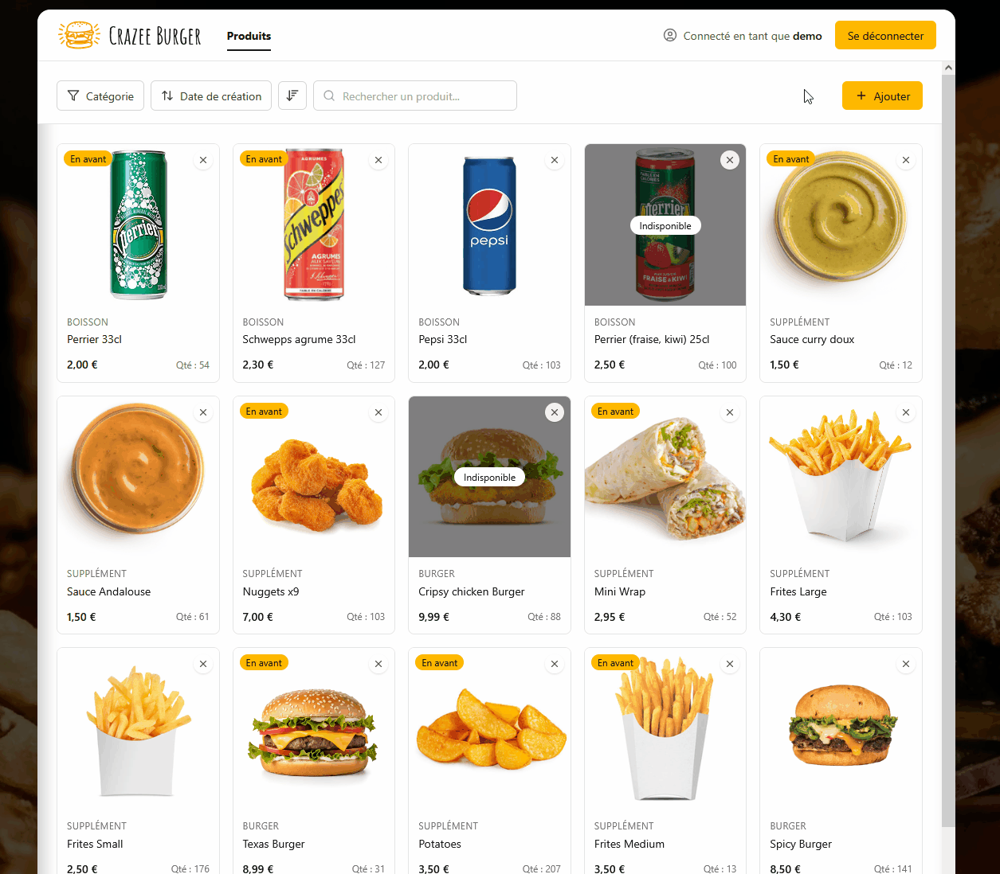

# 🍔 Crazee Burger — Back-office

[](https://github.com/lletierce/crazee-burger3-admin/actions/workflows/ci.yml)

> Back-office de gestion de menu pour restaurant : les administrateurs gèrent le catalogue de produits (ajout, modification, suppression, disponibilité, mise en avant).

🔗 **Démo en ligne : [crazee-burger-dev-adm.web.app](https://crazee-burger-dev-adm.web.app/)**



---

## 🔑 Tester l'application

Un compte de démonstration est disponible :

| Email | Mot de passe |
|---|---|
| `demo@exemple.com` | `CrazeeBurger123*` |

> Tu peux tout modifier : le bouton **« 🧪 Mode démo · Réinitialiser »**, en bas à gauche de l'écran, remet le catalogue dans son état d'origine en un clic.

---

## ✨ Fonctionnalités

- **Authentification** : connexion, déconnexion, réinitialisation du mot de passe par email, affichage du mot de passe à la saisie
- **Gestion des produits (CRUD)** : ajout, modification et suppression, avec confirmation et notifications
- **Catalogue** : filtre par catégorie (Burger, Boisson, Supplément), tri (nom, prix, quantité, date de création), recherche, **défilement infini**
- **Fiche produit** dédiée, avec fil d'Ariane
- **Disponibilité** (en stock / épuisé) et **mise en avant** de produits
- **Design responsive** : mobile, tablette et ordinateur
- **Accès sécurisé** : seuls les administrateurs peuvent consulter et modifier le menu

---

## 🛠️ Stack technique

| Domaine | Technologies |
|---|---|
| Front-end | React 19, TypeScript, Vite |
| Style | Tailwind CSS 4 |
| Navigation | React Router 7 |
| Back-end (BaaS) | Firebase Authentication, Cloud Firestore |
| Tests | Vitest, React Testing Library |
| CI/CD | GitHub Actions, Firebase Hosting |

---

## 🧩 Choix techniques

### Architecture par features

Le code est organisé par domaine métier plutôt que par type de fichier :

```
src/
├── app/        # Assemblage de l'application : routage, layouts, providers, config Firebase
├── features/   # Logique métier par domaine (auth, products) : API, hooks, composants, types
├── pages/      # Pages, qui composent les features
└── shared/     # Code réutilisable sans logique métier : UI, hooks, utilitaires
```

Les tests sont placés à côté des fichiers qu'ils testent (`Composant.test.tsx`).

### Pagination Firestore et défilement infini

Les produits sont chargés **par pages de 20**, avec une pagination par curseurs (`startAfter`) plutôt que par numéro de page : chaque requête reprend exactement après le dernier produit reçu. La page suivante se charge automatiquement quand l'utilisateur arrive en bas de la liste (`IntersectionObserver`), et le filtre, le tri et la recherche relancent la pagination depuis le début.

### Expérience de chargement

- **Skeletons** qui reproduisent la forme exacte de la page (navbar, barre d'outils, grille), pour que rien ne « saute » quand le contenu arrive.
- **Délai de 300 ms** avant d'afficher un skeleton : une attente courte passe directement à la page, sans loader qui clignote (hook `useDelayedFlag`).
- **Couleur de fond définie dès le HTML** : pas de flash blanc avant le démarrage de React.
- **Image de fond optimisée** : 1,7 Mo → 130 Ko (WebP redimensionné), non téléchargée sur mobile, avec un fondu à l'affichage.

### Accessibilité

Libellés et états ARIA sur les éléments interactifs (`aria-label`, `aria-pressed`, `aria-busy`), focus visible au clavier, respect de la préférence « réduire les animations » du système.

---

## 🔒 Sécurité

La sécurité des données ne repose pas sur l'interface, mais sur les **règles de sécurité Firestore** ([`firestore.rules`](./firestore.rules)), versionnées dans ce dépôt :

- **Accès refusé par défaut** : toute collection non déclarée est inaccessible.
- **Gestion des rôles** : seuls les utilisateurs présents dans la collection `admins` peuvent lire et modifier les produits. Cette collection n'est modifiable que depuis la console Firebase.
- **Validation des données côté serveur** : chaque produit est vérifié avant écriture (champs autorisés et obligatoires, types, longueur du nom, catégorie, prix et quantité positifs).
- **Intégrité** : la date de création d'un produit ne peut pas être modifiée.

Côté interface, les routes privées redirigent vers la connexion, et la page de connexion redirige un utilisateur déjà connecté vers le catalogue.

---

## ⚙️ Qualité et CI/CD

Chaque modification passe par une **pull request** et un pipeline GitHub Actions ([`ci.yml`](./.github/workflows/ci.yml)) :

1. **Lint** (ESLint), **vérification des types** (TypeScript) et **tests** (Vitest)
2. **Build** de production, réalisé une seule fois puis réutilisé pour les déploiements
3. **Déploiement de prévisualisation** : chaque pull request obtient sa propre URL temporaire, publiée en commentaire
4. **Déploiement en production** automatique à chaque merge sur `main`

Le dépôt suit le **GitHub Flow** (une branche courte par ticket) et la convention **Conventional Commits** (`feat`, `fix`, `refactor`…).

---

## 📖 Origine du projet

Ce projet est né lors de la formation **Développeur React — Vi-Dev**, où j'ai réalisé une première version en JavaScript avec Firebase et Styled-components.

Je l'ai ensuite **repris et fait évoluer seul** avec Claude :

- Migration complète de **JavaScript vers TypeScript**
- Ajout de l'**authentification** (connexion, réinitialisation du mot de passe)
- Nouveau **design responsive** avec **Tailwind CSS**
- **Pagination Firestore** et **défilement infini**
- Écriture des **règles de sécurité Firestore** (rôles, validation des données)
- **Tests** unitaires et de composants (Vitest, React Testing Library)
- **CI/CD** avec GitHub Actions et déploiement sur Firebase Hosting

---

## 🚀 Installation en local

### Prérequis

- [Node.js](https://nodejs.org/) (version LTS)
- Un projet [Firebase](https://console.firebase.google.com/) avec Authentication (email/mot de passe) et Firestore activés

### Étapes

```bash
# 1. Cloner le dépôt
git clone https://github.com/lletierce/crazee-burger3-admin.git
cd crazee-burger3-admin

# 2. Installer les dépendances
npm install

# 3. Configurer les variables d'environnement
cp .env.example .env
# puis renseigner les valeurs de ton projet Firebase dans .env

# 4. Lancer le serveur de développement
npm run dev
```

Pour accéder au catalogue, ton utilisateur doit être déclaré administrateur : crée un document dans la collection `admins` de Firestore, avec l'UID de l'utilisateur comme identifiant.

### Variables d'environnement

```env
VITE_FIREBASE_API_KEY=
VITE_FIREBASE_AUTH_DOMAIN=
VITE_FIREBASE_PROJECT_ID=
VITE_FIREBASE_STORAGE_BUCKET=
VITE_FIREBASE_MESSAGING_SENDER_ID=
VITE_FIREBASE_APP_ID=
VITE_DEMO_MODE=
```

### Scripts disponibles

| Commande | Description |
|---|---|
| `npm run dev` | Lance le serveur de développement |
| `npm run build` | Vérifie les types et génère la version de production dans `dist/` |
| `npm run preview` | Prévisualise la version de production en local |
| `npm run lint` | Analyse le code avec ESLint |
| `npm run typecheck` | Vérifie les types TypeScript |
| `npm test` | Lance les tests en mode surveillance |
| `npm run test:run` | Lance les tests une seule fois (utilisé par la CI) |

---

## ☁️ Déploiement

L'application est déployée **automatiquement** par GitHub Actions (voir la section *Qualité et CI/CD* ci-dessus).

Les règles de sécurité Firestore se déploient à part, manuellement :

```bash
firebase deploy --only firestore:rules
```

---

## 🗺️ Évolutions prévues

- [ ] **Tableau de bord** : chiffres clés du catalogue (produits par catégorie, épuisés, mis en avant)
- [ ] **Codes promo** : création, dates de validité, activation
- [ ] **Gestion des catégories** depuis l'interface
- [ ] **Application client** de commande, séparée du back-office

---

## 👤 Auteur

**Loris LETIERCE** — Développeur React junior, en recherche d'emploi

[LinkedIn](https://www.linkedin.com/in/loris-letierce-9863a1159) · [GitHub](https://github.com/lletierce) · [Email](mailto:letierce.lo@gmail.com)
